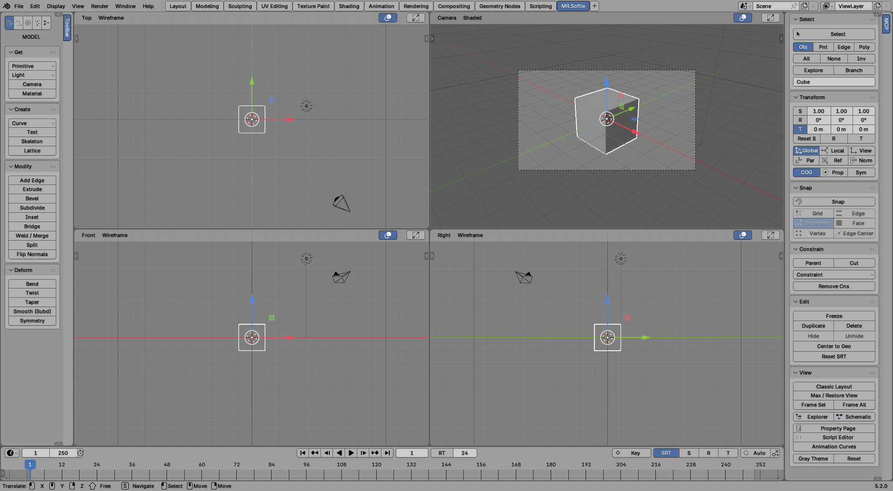

# MR.Softie

A classic SI-style workflow for Blender. It's for people who learned 3D on the old-school gray DCC and still reach for V, C, X and the spacebar.

MR.Softie is free and open source (GPL-3.0-or-later). It is **not affiliated with or endorsed by Autodesk**. All names, icons and artwork here are original; the project recreates *workflow*, not anyone's software.



## Features

**The MR.Softie workspace.** Press **N** in any 3D view, open the **MCP** tab and click **Classic Layout**. You get a dedicated **MR.Softie** workspace tab:

- **Module toolbar** on the left: an icon row switches between **Model / Animate / Render / Simulate / ICE**, each with its own collapsible command stacks.
- **Four independent viewports** in the middle, in the classic default arrangement: Top, Camera, Front, Right. Each has its own header with a view menu (Camera, User, Top, Bottom, Front, Back, Right, Left) and a display menu (Wireframe, Shaded, Textured, Material, Rendered), plus maximize / restore.
- **Schematic view** (9, or View > Schematic): the scene graph as color-coded nodes, one per object, with hierarchy links and constraint links. Draw a link from a node's Children output to another node's Parent input to parent it (world position kept); cut the link to unparent. Cycles are refused. Selecting nodes selects objects and the other way round. **Rearrange** lays it out as a tree.
- **Explorer** (8): the scene hierarchy in its own window, with visibility, selectability and render columns.
- **Property pages** (Enter): a floating page for the selected object with Kinematics, Visibility, Display, Geometry/Light/Camera settings, Material and Constraints. Pin one to keep it on a specific object.
- **Classic main menu bar**: File, Edit, Display, View, Render, Window, Help. The View menu opens every editor as a floating window (Explorer, Animation Editor, Mixer, Render Tree, ICE Tree, Script Log...).
- **The MCP** as a full-height column on the right.
- **Timeline** along the bottom, and a **mouse status line** that always shows what Left / Middle / Right do right now.
- **Gray theme**: light-gray UI with black text, flat gray viewports, black wires, white selection. **Reset** restores Blender's theme.
- **Original icon set** for the modules, Select, Explorer, Schematic, Property Page and Script Editor.

**Module toolbar**

| Module | Sections |
|---|---|
| Model | Get (Primitive, Light, Camera, Material), Create (Curve, Text, Skeleton, Lattice), Modify (Extrude, Bevel, Subdivide, Inset, Bridge, Weld, Split, Flip Normals), Deform (Bend, Twist, Taper, Smooth, Symmetry) |
| Animate | Get, Keys (Save / Remove Key, Remove Anim), Create (Path and Track constraints, Skeleton), Mixer (Store Clip, Open Mixer), Editors (Anim Editor, Dopesheet) |
| Render | Get (Light, Camera, Material), Render (Frame, Anim, Region, Preview), Passes, Partitions, Channels, Editors (Render Tree, Texture Editor, Options) |
| Simulate | Create (Rigid / Passive Body, Cloth, Soft Body, Particles, Forces), Simulate (Play, Bake All, Free Bakes) |
| ICE | Create (ICE Tree), Compounds (Emit from Surface, Simulate Particles, Jitter, Push, Grow Strands, Strand Dynamics, Turbulence, Swarm), Simulate (Play, Reset, Bake, Free) |

**The MCP**, stacked in the classic order:

| Section | What it does |
|---|---|
| Select | Select tool, Obj / Pnt / Edge / Poly, All / None / Inv, Explore, Branch, name of selection |
| Transform | S / R / T rows with live x/y/z values (the active tool lights up), Reset S / R / T, Global / Local / View / Par / Ref / Norm, COG, Prop, Sym |
| Snap | Snap on/off, Grid / Increment / Vertex / Edge / Face / Edge Center |
| Constrain | Parent, Cut, add constraint, remove all |
| Edit | Freeze (bake modifier stack), Duplicate, Delete, Hide / Unhide, Center to Geo, Reset SRT |
| View | Classic Layout, Max / Restore, Frame Sel / All, floating Explorer, Schematic, Property Page, Curves and Script Editor, Gray Theme |

The MCP is also available as a sidebar tab in every other workspace.

**SRT tools and manipulator.** Drag *anywhere* in the viewport, or grab the manipulator: arrows for Translate (V), rings for Rotate (C), boxes for Scale (X). Each handle constrains to its axis; the center ring is free. The manipulator can be switched off in preferences.

- Left / Middle / Right drag = X / Y / Z
- Shift + Left drag = free (view plane, view axis, or uniform scale)
- Click = select (Shift adds, Ctrl toggles)

**Component tools.** **Tweak** (M): drag a point, edge, polygon or object to move it directly. **Raycast** (MCP > Select, in component mode): paint over visible components to select them, Shift adds, Ctrl removes. **Add Edge** (`\` or Modify > Add Edge): cut new edges across polygons.

**ICE compounds.** ICE trees are Geometry Nodes trees, so everything stays editable. Each compound is a node group you can open, tweak and reuse:

- **Emit from Surface**: select the object to scatter, then the surface last. Copies land all over the surface with random rotation and scale; the source object is hidden from render.
- **Simulate Particles**: points shoot off the surface along its normals and fall under gravity (a simulation zone). Press Play; Bake to cache.
- Particles can bounce off a floor: turn on **Floor** in the modifier and set **Floor Height** and **Bounce**.
- Particles collide with any mesh: select the collider, then the emitter last, and click **Simulate Particles** (or pick a **Collider** in the modifier). They land on its surface and bounce.
- **Swarm**: a flock. Each member keeps its distance from its nearest neighbor (**Separation**, **Personal Space**), matches its heading (**Alignment**), drifts toward the flock's center (**Cohesion**), wanders, and flies toward a **Goal** object (select the goal, then the emitter last). Without a goal it circles the emitter. Pick an **Instance** object in the modifier and copies fly along, facing the way they move.
- **Grow Strands**: hair-like curves growing out of the surface, with length variation and thickness. Turn up **Wind** and they sway, more at the tips.
- **Strand Dynamics**: makes strands move like hair. They droop under **Gravity**, sway in **Wind**, and lag and overshoot when you animate the object; stiffer at the root, looser at the tip. They keep their length (**Keep Length** sets how hard it tries), and stay outside the body (**Collide With Body**) and an optional **Collider** object. Click it on a mesh without strands and it grows them first.
- **Turbulence**: animated noise that keeps moving the points as the frame changes.
- **Jitter** and **Push**: random offset, and inflate / deflate along normals.

Change Density, Seed, Speed, Gravity and so on in the modifier, or open the tree with **ICE Tree**.

**Render passes and partitions.** In the Render module:

- **Passes** lists every pass (Blender view layer). Click one to make it current, **New** / **Delete**, rename, and **Render** renders only the current one. **Preset** makes a pass with its channels already on: Beauty, Diffuse, Specular, Shadow, Ambient Occlusion, Depth, Normal, Matte. **Region** / **Draw** set a render region, and each pass remembers its own.
- **Partitions** are the scene's top-level collections. **New from Selection** moves the selected objects into a new partition. Each row is per pass: the checkbox shows or hides the partition in this pass, then Matte (holdout) and Indirect (casts shadows and reflections without being seen).
- **Channels**: Depth, Normal, Mist, AO, Diffuse, Emit, Object and Material ID mattes for the current pass.

**Timeline and keying.** The bottom strip in the MR.Softie workspace reads left to right: Start / End, transport (first, previous key, previous frame, play backward, play, next frame, next key, last), current frame, **RT** (real-time playback, drops frames to keep speed) and frame rate, then the animation controls:

- **Key** (or **K**) saves a key on the *marked* parameters of the selection. The button turns red when the active object has a key on this frame, and highlights when it's animated but not keyed here.
- **SRT / S / R / T** chooses which parameters are marked.
- **Auto** is auto-key; the key icon next to it removes the key on this frame.

**Script Editor** (**Alt+4**, View > Script Editor, or MCP > View): one window with the command log on top (every command you run, as Python) and a script editor underneath; copy lines down and press Run Script. The status bar's script line shows the last command; click it to open the Script Editor.

**Mixer clips.** Animate > Mixer > **Store Clip** moves the selection's animation onto a Mixer (NLA) track as a clip, so you can layer, blend and reuse it.

**Supra modes.** Tap V / C / X / Space to switch tools. **Hold** one instead and it's a temporary tool: let go and you're back to what you had. Object mode and component mode each remember their last tool, so switching back and forth (Space, T / E / Y) puts you back on the tool you were using.

**Classic hotkeys** (can be switched off in preferences):

| Key | Action |
|---|---|
| Space | Object selection (also leaves component mode) |
| V / C / X | Translate / Rotate / Scale (tap to switch, hold for temporary) |
| T / E / Y | Point / Edge / Polygon selection |
| S + Left / Middle / Right | Pan / Dolly / Orbit |
| F / A | Frame selection / Frame all |
| Ctrl+A | Select all |
| Ctrl+D | Duplicate |
| Ctrl+Y | Redo |
| K | Save Key on the marked parameters |
| Alt+4 | Script Editor |
| Enter | Property page for the selection |
| M | Tweak tool |
| \ | Add Edge (component mode) |
| Alt + Right click | Context menu |
| 1 / 2 / 3 / 4 / 5 | Toolbar module: Model / Animate / Render / Simulate / ICE |
| 7 / 8 / 9 / 0 | Render tree / Explorer / Schematic / Animation editor |

## Install

Requires Blender 4.2 or newer (tested on 5.2).

**Recommended: add MR.Softie as a repository (you get updates automatically)**

1. In Blender, go to **Edit → Preferences → Get Extensions**. If it asks, click **Allow Online Access** (or turn it on under **System → Network**).
2. Open the **Repositories** dropdown (top right) and click **+ → Add Remote Repository**.
3. Paste this URL and turn on **Check for Updates on Startup**:
   ```
   https://raw.githubusercontent.com/JavTsPlayground/mr-softie/main/download/index.json
   ```
4. Search **MR.Softie** in Get Extensions and click **Install**. (If you installed it from a zip before, uninstall that copy first.)
5. In the 3D view, press **N**, open the **MCP** tab, and click **Classic Layout**. From then on, just click the **MR.Softie** workspace tab.

**Or install the zip once by hand:** **[download mr_softie-1.1.0.zip](https://github.com/JavTsPlayground/mr-softie/raw/main/download/mr_softie-1.1.0.zip)** (don't unzip it), then **Get Extensions → ▾ → Install from Disk**. You won't get automatic updates this way.

**Optional: open Blender straight into MR.Softie.** In the add-on's preferences (or **Edit > Install MR.Softie App Template**), click **Install App Template**. MR Softie then shows up in **File > New** and on the splash screen.

A five-page setup and quick-start guide (install, tour, hotkeys, troubleshooting) is in [docs/MR-Softie-Setup-Guide.pdf](docs/MR-Softie-Setup-Guide.pdf).

## Known differences from the original

- These hotkeys replace Blender's own: Space (play), K (keying menu; knife is on `\`), C (circle select), V (rip, in edit mode), X (delete), E (extrude), A (select all), F (fill), T (toolbar), S (scale), and 5/7/8/0 when number keys are enabled. Turn **Classic Hotkeys** off in preferences to get Blender's back.
- ICE is built on Geometry Nodes: compounds are node groups, and the ICE Tree is the Geometry Nodes editor. Node names are Blender's.
- Partitions are collections, so a partition belongs to every pass; what changes per pass is whether it's visible, a matte or indirect.
- The toolbar and MCP columns show a small vertical tab label ("Toolbar", "MCP"); Blender always draws one.
- The classic headers and menu bar only appear in the MR.Softie workspace; every other workspace stays stock Blender.
- The layout's column widths are tuned at 1920x1080. On other screens, click **Classic Layout** again to snap them back.

## Roadmap

- ICE: strand-to-strand collisions, more compounds (Surface Attract, Trails)
- More original icons across the MCP

## Development

```bash
pip install bpy
python tests/test_headless.py      # must end with "0 failure(s)"
python docs/make_guide.py          # rebuild the setup guide (needs reportlab + pillow)
python docs/make_icons.py          # redraw the icon set into mr_softie/icons (needs pillow)
```

To release a new version: bump `version` in `mr_softie/blender_manifest.toml`, zip `mr_softie/` into `download/mr_softie-<version>.zip`, delete the old zip, then regenerate the index with `blender --command extension server-generate --repo-dir download`.
